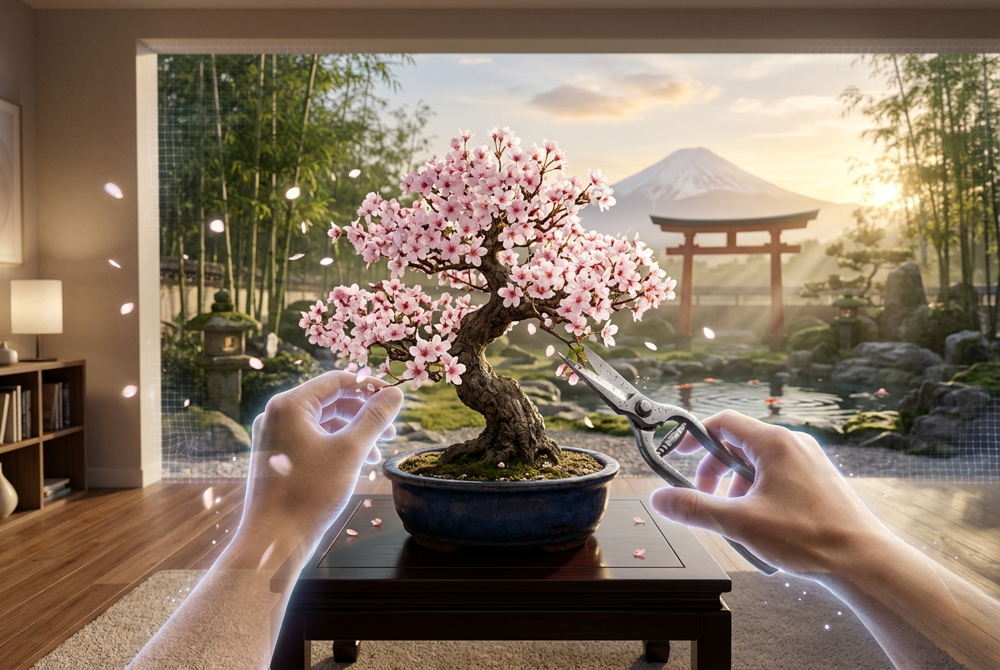

# 🌸 ZenBonsai: Mixed Reality Oasis

> **A hands-first MR botanical sanctuary for Meta Quest 3.**  
> Transform your living room into an authentic Kyoto sanctuary. Master the art of bonsai using intuitive hand tracking, traditional artisan tools, and calming soundscapes.



---

## ⛩️ Overview

**ZenBonsai: Mixed Reality Oasis** is an immersive Mixed Reality (MR) experience developed in Unity 6 for the **Meta Quest 3**. Combining color Passthrough, natural hand-tracking algorithms, and procedural botanical generation, it brings the meditative Japanese art of bonsai directly into your physical living space.

---

## ✨ Key Features

- **👐 Natural Hand-Tracking Interaction:** Pick up traditional pruning shears, grab the bamboo ladle, and groom trees without controllers.
- **🌱 Three Masterpiece Species:**
  - **🌸 Sakura Moyogi (Cherry Blossom):** Dynamic blooming corollas and drifting 3D petals that sway with gentle breeze physics.
  - **🌲 Kuromatsu (Japanese Black Pine):** Ancient scaled bark plates, *Dan-zukuri* needle cloud pads, and deadwood *Jin/Shari* veins.
  - **🍁 Yama-Momiji (Japanese Maple):** Authentic *Sokan* (dual-trunk) composition with 5-pointed palmate star leaves and vivid autumnal colors.
- **🛠️ Traditional Artisan Tools:**
  - *Satsuki Hasami* (Japanese pruning shears) with interactive scissor physics.
  - *Hoki* (bamboo hand broom) to gently brush away pests from the trunk and moss.
  - *Tsukubai* stone water basin and *Hishaku* bamboo water ladle with crystal-clear fluid pouring.
- **🎋 Table-Front Control Console:** Low-profile Urushi lacquer console mounted to the front rim of the display table with millimeter-precise index-fingertip poke detection.
- **🏯 360° Virtual Kyoto Sanctuary:** Seamlessly switch between Passthrough MR and a full 360° Japanese sanctuary complete with an *Engawa* wooden veranda, raked *Karesansui* gravel, koi pond, vermilion *Torii* gate, stone *Toro* lanterns, and a snow-capped Mount Fuji.
- **🎵 Zen Soundscape:** Real-time soothing procedural audio including Shakuhachi flute melodies, singing Tibetan meditation bowls, and gentle mountain wind.

---

## 🛠️ Tech Stack & Requirements

- **Engine:** Unity 6 (URP - Universal Render Pipeline)
- **Target Hardware:** Meta Quest 3 / Quest 3S / Quest Pro
- **SDKs:** Meta XR Core SDK, Meta XR Interaction SDK
- **Language:** C#
- **Input:** Meta Quest Hands-First Tracking (Touch Controllers also supported)

---

## 🚀 Getting Started

1. Clone this repository:
   ```bash
   git clone https://github.com/YOUR_USERNAME/ZenBonsai-Mixed-Reality-Oasis.git
   ```
2. Open the project in **Unity 6 (6000.0.x)** with the Android Build Support module installed.
3. Switch platform to **Android**.
4. Open the main scene: `Assets/Scenes/SampleScene.unity`.
5. Connect your Meta Quest 3 via USB or Quest Link and click **Build and Run**.

---

## 📄 License

This project was built for the Meta Quest Mixed Reality Hackathon. All rights reserved.
